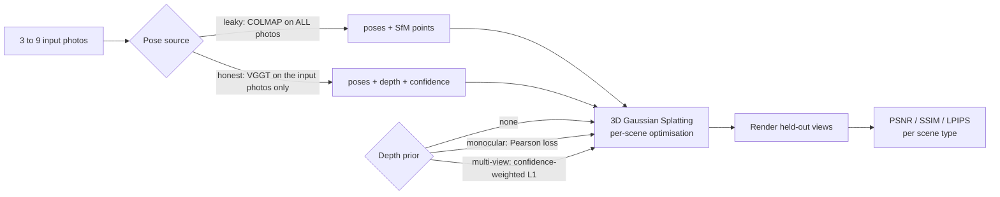
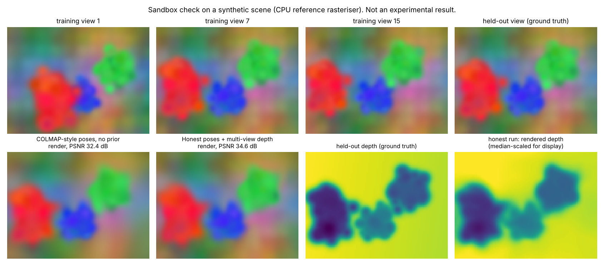

# 3D scene reconstruction from few images

**An honest-protocol study of few-view 3D Gaussian Splatting: when the camera poses come only from the 3 to 9 input photos, which depth prior actually helps, a monocular one or a multi-view one, and on which kinds of scene does each one hurt?**

> **Status (15 Nov 2026).** The code is complete and tested on CPU (43 tests, including both evaluation protocols end to end on a synthetic scene). The GPU path through `gsplat` and the two prior models (VGGT, Depth Anything V2) has **not been run yet**, because the development sandbox has no GPU. **There are no experimental results in this repository yet.** Every table below that needs numbers is marked *pending*, and nothing here claims to beat another method until those numbers exist.

---

## 1. The problem

Give a computer 100 photos of a room and 3D Gaussian Splatting (3DGS) will rebuild it well enough to render new viewpoints that look like photographs. Give it **3 photos** and it falls apart: with so few views there are many 3D scenes that reproduce the 3 photos exactly, and the optimiser picks one full of "floaters" and warped geometry that looks wrong from anywhere else.

The usual fix is a **prior**: extra knowledge about depth that fills in what 3 photos cannot determine. Dozens of papers do this. This project asks two questions those papers mostly skip.

### Question 1: are the reported numbers honest about camera poses?

To train 3DGS you need the camera pose of every photo. Almost every few-view paper gets those poses by running COLMAP on **all** the photos of the scene (often 20 to 300), then throws away everything except 3 views and calls it "3-view reconstruction".

But the 3 poses that remain were computed using all the other photos. Geometry from the held-out views has leaked into the training setup: into the poses, and usually into the initial point cloud too. Somebody who really has only 3 photos cannot do this. We call this the **leaky protocol**.

The **honest protocol** in this repository estimates poses, intrinsics and the initial points from the training views alone, using a multi-view foundation model (VGGT). The first thing we measure is how much of the published quality survives that change.

### Question 2: which prior helps, and where does it hurt?

There are now two families of depth prior:

| | Monocular (Depth Anything V2) | Multi-view (VGGT) |
|---|---|---|
| Looks at | one image at a time | all input views together |
| Output | relative inverse depth, unknown scale and shift per image | depth in one shared frame, plus a per-pixel confidence |
| Consistent across views | no | yes, by construction |
| Typical loss | Pearson correlation (scale and shift invariant) | direct L1, weighted by confidence |

A prior is not free. On a scene that the views already cover well, forcing the geometry toward an imperfect depth map can make the renders *worse*. We break results down by scene type (foliage, textureless, reflective, thin structures, indoor/outdoor, forward-facing vs 360°) to find where each prior helps and where it does damage.

## 2. What the project does



Every experiment is one cell of a 2 × 3 grid, run on the same train/test split:

| | No prior | Monocular depth | Multi-view depth (confidence-weighted) |
|---|---|---|---|
| **Leaky poses** (full-view COLMAP) | vanilla 3DGS baseline | the FSGS / SparseGS recipe | multi-view prior, aligned per image |
| **Honest poses** (input views only) | what 3 photos really give you | does a mono prior survive honest poses? | poses and depth from one model, one frame |

Comparing the two rows gives the **pose-leakage gap**. Comparing the columns within a row, per scene type, gives the **help/hurt map**.

### The pieces, and where they live

| Step | What happens | Code |
|---|---|---|
| Splits | Sort images by name, hold out every 8th for testing, pick the training views evenly from the rest (the RegNeRF/FSGS convention). Saved to JSON once and read by every run. | `fewview3d/splits.py` |
| Leaky poses | Read COLMAP's full-view cameras. Initial points are the SfM points seen by at least two *training* views (`sfm_train`), or all of them (`sfm_all`, the most common and most leaky choice). | `fewview3d/dataset.py`, `colmap_io.py` |
| Honest poses | Run VGGT on the training views only. It returns poses, intrinsics, depth and confidence. The initial points are the confident depth pixels lifted to 3D. | `fewview3d/priors/vggt_runner.py` |
| Leak guard | The prior file records which images it was computed from. A run refuses to start if they differ from its training views, and refuses full-view SfM points under honest poses. | `fewview3d/priors/__init__.py`, `experiment.py` |
| Monocular loss | `1 − Pearson(1/depth_rendered, disparity_prior)`. Invariant to the unknown scale and shift. | `fewview3d/losses.py` |
| Multi-view loss | `Σ w·|D_rendered − D_prior| / Σ w`, with `w` from the model's confidence (per-image quantile ramp). Under honest poses the depth and the cameras share one frame, so no alignment is needed. Under COLMAP poses the prior is aligned by weighted least squares first. | `fewview3d/losses.py` |
| Training | 3DGS with gsplat's rasteriser and densification, colour loss `0.8·L1 + 0.2·(1 − SSIM)`, plus `λ ·` depth loss. | `fewview3d/experiment.py` |
| Honest evaluation | The scene lives in VGGT's coordinate frame, so ground-truth test cameras are mapped into it with a Sim(3) fitted on the training cameras, then each test camera is refined photometrically with the Gaussians frozen (as InstantSplat and CF-3DGS do). PSNR before and after refinement are both stored. | `fewview3d/geometry.py`, `pose_refine.py` |
| Analysis | Main table (mean ± std over seeds), pose-leakage table, gain of each prior by scene type with a count of scenes it hurt. | `fewview3d/aggregate.py` |

## 3. How this differs from existing work

This table describes what each line of work does. It makes no claim about who scores higher: that comparison needs the GPU runs.

| Work | Poses for training | Prior | What this project adds |
|---|---|---|---|
| 3DGS (Kerbl et al., 2023) | full-view COLMAP | none | The baseline, in both protocols. |
| FSGS, SparseGS, DNGaussian (2024) | full-view COLMAP | monocular depth | Re-tested when the poses no longer come from held-out views. |
| InstantSplat, CF-3DGS (2024) | estimated from the input views | geometry from DUSt3R / none | Same honest evaluation idea. They propose a pipeline; we compare prior families inside one fixed pipeline. |
| Confidence- or uncertainty-weighted depth supervision (2024 to 2026) | mostly full-view COLMAP | monocular or stereo, weighted | We use the weighting as a component and ablate it (`--conf-mode none/threshold/soft`), not as the headline. |
| AnySplat and other feed-forward splatting (2025) | none needed | learned end to end | A reference point: when is per-scene optimisation still worth its minutes? |

**Intended contribution, to be confirmed by results:**

1. A measurement of how much few-view 3DGS quality depends on leaked full-view poses.
2. A controlled comparison of monocular and multi-view depth priors under identical poses, splits and optimiser.
3. A per-scene-type account of where each prior hurts.
4. A small, reproducible codebase with leak guards, so the protocol cannot be broken by accident.

## 4. Datasets

| Dataset | Scenes | What it is | Setting used |
|---|---|---|---|
| **LLFF** (Mildenhall et al., 2019) | fern, flower, fortress, horns, leaves, orchids, room, trex | Real forward-facing captures, 20 to 62 photos each | 3, 6 and 9 training views, 1/8 resolution (about 504 × 378) |
| **Mip-NeRF 360** (Barron et al., 2022) | bicycle, bonsai, counter, garden, kitchen, room, stump | Real unbounded 360° captures, 125 to 311 photos each | 12 and 24 training views, 1/8 resolution |
| **DTU** (planned) | object scans | Has ground-truth geometry | To separate render quality from geometric accuracy |
| Synthetic (in this repo) | one generated scene | Exact poses and depth | Tests only, never reported |

Both real datasets ship with COLMAP reconstructions, which serve as the leaky poses and as ground truth for measuring how accurate the honest poses are. Scene-type tags are in `fewview3d/registry.py`; they are a first pass and will be refined once renders exist.

## 5. Results

**Pending.** After the GPU runs, `python scripts/aggregate.py` writes `results/RESULTS.md` and `results/results.csv`, and the tables go here.

| Table | Question it answers | Status |
|---|---|---|
| Main table | PSNR / SSIM / LPIPS for all six cells at each view count | pending |
| Pose leakage | How many dB are lost going from full-view COLMAP poses to honest poses | pending |
| Scene types | Gain of each prior over no prior, per scene type, with the number of scenes it hurt | pending |
| Ablations | Confidence weighting on/off, λ sweep, initialisation, training-pose refinement | pending |

### Sandbox check (not a result)



This figure comes from `scripts/demo_synthetic.py`, which runs both protocols on a small synthetic scene using a CPU reference rasteriser. The "estimated" poses and depth there are simulated by perturbing the ground truth. It shows that the pipeline runs from 3 views to held-out renders and depth in both protocols. It says nothing about how the methods rank on real data.

## 6. Running it

### Check the install on a CPU (about 4 minutes, no data needed)

```bash
pip install -e ".[dev]"
python -m pytest            # 43 tests
python scripts/demo_synthetic.py
```

### Real experiments (needs an NVIDIA GPU)

Step-by-step commands for Kaggle and Colab are in [docs/RUNNING_ON_GPU.md](docs/RUNNING_ON_GPU.md). In short:

```bash
python scripts/make_splits.py           --dataset llff --views 3 6 9   # split files
python scripts/estimate_vggt.py         --dataset llff --views 3 6 9   # honest poses + multi-view depth
python scripts/precompute_mono_depth.py --dataset llff --views 3 6 9   # monocular depth
python scripts/run_sweep.py             --dataset llff --views 3 --seeds 0 1 2   # the 2 x 3 grid
python scripts/aggregate.py                                            # tables
```

A single run:

```bash
python scripts/train.py --dataset llff --scenes fern --n-views 3 \
    --pose-source vggt --depth-prior vggt
```

Every option of `ExperimentConfig` (`fewview3d/experiment.py`) is a command-line flag; `python scripts/train.py --help` lists them.

## 7. What has and has not been verified

| Part | Verified how |
|---|---|
| Splits, COLMAP reader, image/intrinsics scaling | Unit tests, including a written-then-read COLMAP model |
| Sim(3) alignment, pose errors, SE(3) exponential, unprojection | Unit tests against known transforms, including 2 cameras and collinear centres |
| Pearson and confidence-weighted depth losses, alignment solver | Unit tests for invariances, outlier weighting and gradients |
| Reference rasteriser | Unit tests: projection, depth, occlusion order, gradients to Gaussians and to the camera |
| Both protocols end to end, leak guards, test-pose refinement, densification | Tests on the synthetic scene with gsplat's real densification strategy |
| Command-line scripts and aggregation | Run as subprocesses on a COLMAP export of the synthetic scene |
| **gsplat CUDA rasteriser path** | **Not run. Written against the gsplat 1.5 API; first GPU run should be treated as a test.** |
| **VGGT and Depth Anything V2 inference** | **Not run. Pre- and post-processing are tested; the model calls are not.** |

## 8. Repository layout

```
fewview3d/            library
  splits.py           train/test splits
  dataset.py          COLMAP scene loading          colmap_io.py   binary reader/writer
  geometry.py         Sim(3), SE(3), pose errors    losses.py      photometric + depth losses
  render.py           gsplat backend + CPU reference rasteriser
  gaussians.py        initialisation, optimisers    pose_refine.py test-time pose refinement
  experiment.py       protocols, training loop, evaluation
  priors/             prior file format, VGGT and Depth Anything V2 runners
  aggregate.py        result tables                 registry.py    datasets, scene types
  synthetic.py        synthetic scene for tests
scripts/              make_splits, estimate_vggt, precompute_mono_depth, train, run_sweep, aggregate, demo_synthetic
tests/                43 CPU tests
docs/                 RUNNING_ON_GPU.md, RESEARCH_LOG.md
```

## 9. Roadmap

- [ ] First GPU run: full-view 3DGS on LLFF `fern`, compare with published numbers to validate the gsplat path
- [ ] Vanilla 3DGS at 3/6/9 views on LLFF, 3 seeds (reproduce the few-view failure)
- [ ] The 2 × 3 grid on LLFF, then Mip-NeRF 360
- [ ] λ and confidence ablations on one scene, then all scenes
- [ ] Published baselines on the same splits: FSGS, InstantSplat, AnySplat
- [ ] DTU for geometric accuracy; Depth Anything 3 as a second multi-view prior
- [ ] Region-level scene-type labels and depth-error maps
- [ ] Paper draft: CVPR 2027 workshop and arXiv first, then ICCV 2027

## 10. References

- Kerbl et al., *3D Gaussian Splatting for Real-Time Radiance Field Rendering*, SIGGRAPH 2023
- Ye et al., *gsplat: An Open-Source Library for Gaussian Splatting*, 2024
- Mildenhall et al., *Local Light Field Fusion*, SIGGRAPH 2019 (LLFF)
- Barron et al., *Mip-NeRF 360*, CVPR 2022
- Niemeyer et al., *RegNeRF*, CVPR 2022 (few-view split protocol)
- Zhu et al., *FSGS: Real-Time Few-Shot View Synthesis using Gaussian Splatting*, ECCV 2024
- Li et al., *DNGaussian*, CVPR 2024; Xiong et al., *SparseGS*, 2023
- Fan et al., *InstantSplat*, 2024; Fu et al., *COLMAP-Free 3D Gaussian Splatting*, CVPR 2024
- Wang et al., *DUSt3R*, CVPR 2024; Wang et al., *VGGT: Visual Geometry Grounded Transformer*, CVPR 2025
- Yang et al., *Depth Anything V2*, NeurIPS 2024; *Depth Anything 3*, arXiv 2511.10647
- Jiang et al., *AnySplat*, arXiv 2505.23716

Model licences: the original VGGT-1B checkpoint is for non-commercial use. Check each model's and dataset's terms before redistributing outputs.
